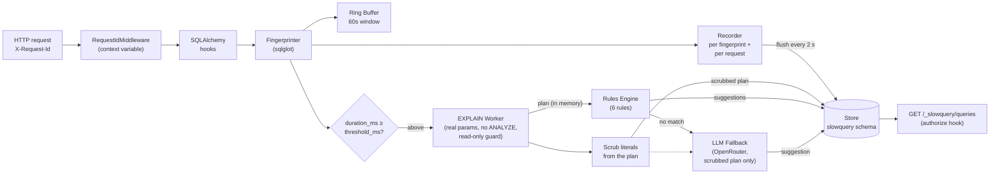
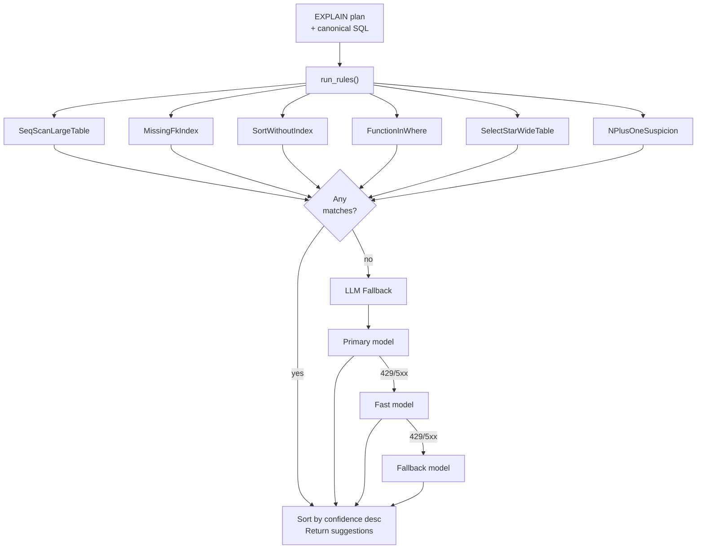
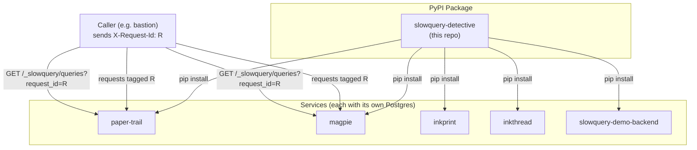

# 🔍 `slowquery-detective`

> 🐢 **Catch slow Postgres queries live. Suggest the index. Know which request caused them.**
> Drop-in FastAPI + SQLAlchemy middleware that fingerprints every query, attributes it to the request that ran it, runs EXPLAIN off the request path, and fixes what's actually slow.

[📦 PyPI](https://pypi.org/project/slowquery-detective/) · [📖 Specs](docs/specs/) · [📝 Changelog](CHANGELOG.md) · [🐛 Issues](https://github.com/Abdul-Muizz1310/slowquery-detective/issues) · [📜 License](LICENSE)

[](https://pypi.org/project/slowquery-detective/)
[](https://github.com/Abdul-Muizz1310/slowquery-detective/actions/workflows/ci.yml)


---

```python
from slowquery_detective import install

install(app, engine, service="paper-trail",
        store_url=settings.database_url, authorize=verify_platform_token)
```

---

## 🤔 Why this exists

Your ORM generates SQL. Some of it is slow. You find out in production when p95 spikes and on-call pages you. Then you stare at `pg_stat_statements`, guess which query is the culprit, manually run `EXPLAIN`, and hope you remember the right index syntax.

**slowquery-detective** automates that entire loop. It hooks into SQLAlchemy events, fingerprints every query so `WHERE id=1` and `WHERE id=42` collapse into one pattern, tracks latency in a ring buffer, and when a statement crosses `threshold_ms` it runs `EXPLAIN (FORMAT JSON)` on the statement's real parameters — off the request path, never with `ANALYZE`, so the statement is never executed twice — with per-fingerprint rate limiting so a hot endpoint can't flood the worker. A deterministic rules engine catches the 80% of real wins (seq scans, missing FK indexes, sorts without indexes, functions in WHERE, `SELECT *`, N+1). When no rule matches, an OpenRouter-backed LLM explains the plan in plain English. The rules engine catches the boring wins — because real wins are boring and deterministic.

Since 0.2.0 it also answers a second question: **which queries did this request cause?** Send `X-Request-Id: R` and every statement R runs — in the endpoint, a background task, a spawned task — is counted against R and kept in the service's own Postgres, so one call to `GET /_slowquery/queries?request_id=R` on each service gives you a per-request performance receipt across a fleet.

Literal values are scrubbed before anything is stored or sent to an LLM. This is a library, not a service — it runs inside your process and writes only to the database you point it at.

## ✨ Features

- 🔬 **Fingerprinting via sqlglot** — literals scrubbed, patterns collapsed, PII never leaves the process
- 🧾 **Per-request attribution** — `X-Request-Id` follows the request into dependencies, `BackgroundTasks` and spawned `asyncio` tasks; calls, total and max time per request and fingerprint, regardless of threshold
- 🗄️ **Postgres store** — the service's own database, schema `slowquery`, created idempotently at startup, batched writes, 7-day retention
- 🔐 **Your authorization** — the read routes ask an `authorize(request)` hook you supply; no hook, no access
- 📊 **Ring buffer with 60s sliding window** — p50, p95, p99 per fingerprint in constant memory
- ⚡ **Async EXPLAIN on real parameters** — off the hot path, no `ANALYZE`, per-fingerprint cooldown, writes never explained
- 🧠 **6-rule deterministic engine** — seq scan, missing FK index, sort without index, function in WHERE, `SELECT *`, N+1
- 🤖 **LLM fallback via OpenRouter** — 3-model cascade (primary → fast → fallback, free models by default) with per-fingerprint cooldown
- 🧽 **Scrubbed plans** — a plan made with real parameters prints their values; they are replaced with `?` before the plan is stored or sent anywhere

## 🏗️ Architecture

### Data flow



### Rules engine dispatch



### In a fleet



## 📁 Project structure

```
slowquery-detective/
├── src/slowquery_detective/
│   ├── __init__.py          # Public surface: install(), stores, QueryRow, current_request_id
│   ├── middleware.py        # install() — validation and wiring
│   ├── tagging.py           # X-Request-Id → context variable (ASGI middleware)
│   ├── hooks.py             # SQLAlchemy event listeners
│   ├── fingerprint.py       # sqlglot-based SQL fingerprinting
│   ├── buffer.py            # Ring buffer — 60s sliding window, p50/p95/p99
│   ├── recorder.py          # In-memory aggregation between flushes (Batch, merge_batches)
│   ├── runtime.py           # Flush loop, store readiness, retention sweep, lifecycle
│   ├── explain.py           # Background EXPLAIN worker (real parameters, no ANALYZE)
│   ├── plan_scrub.py        # Remove literal values from a plan
│   ├── rules/               # 6-rule deterministic engine
│   ├── llm_explainer.py     # OpenRouter LLM fallback with 3-model cascade
│   ├── store.py             # StoreWriter interface + InMemoryStoreWriter
│   ├── pg_store.py          # PostgresStoreWriter (schema slowquery)
│   ├── store_url.py         # Postgres URL validation / asyncpg normalisation
│   ├── schemas.py           # QueryRow, QueryDetail, … (response models)
│   └── router.py            # GET /queries, GET /queries/{id} behind authorize
├── docs/specs/              # 8 feature specs (Spec-TDD)
├── tests/
│   ├── unit/                # unit + ASGI-level composed-path tests
│   ├── integration/         # Testcontainers Postgres tests
│   ├── store_contract.py    # the behaviour both stores must have
│   └── fixtures/
├── benchmarks/
├── pyproject.toml
└── LICENSE
```

## 🚀 Fleet usage

```bash
pip install "slowquery-detective[fastapi,postgres]"
```

```python
from fastapi import FastAPI, Request
from sqlalchemy.ext.asyncio import create_async_engine
from slowquery_detective import install

app = FastAPI(lifespan=lifespan)          # your own lifespan keeps working
engine = create_async_engine(settings.database_url)  # creating it opens no connection

async def verify_platform_token(request: Request) -> bool:
    return await my_token_verifier(request.headers.get("x-platform-token"))  # your check

install(app, engine, service="paper-trail",
        store_url=settings.database_url, authorize=verify_platform_token)
```

- **Call `install` at app construction, after your own `add_middleware` calls**, before the app serves a request or runs its lifespan: it adds an ASGI middleware and wraps the lifespan. Middleware added after `install` sits outside the tagger, so the queries it runs are not attributed to the request. A second call is a no-op with a warning.
- **`store_url`** is the service's own database URL. `postgres://`, `postgresql://` and Neon's `?sslmode=require&channel_binding=require` are accepted and normalised for asyncpg; `postgresql+psycopg://` is kept as given. The store opens its own small pool (2 + 2 overflow) and creates schema `slowquery` on startup — `CREATE … IF NOT EXISTS` under an advisory lock, so running it on every boot is safe. Leave `store_url` out (tests, SQLite) to use the in-memory store.
- **`authorize`** receives the Starlette `Request` and must return `True` to allow; anything else is 403. Raise `HTTPException(401)` from it if you want a 401. Without the hook every route answers 403.
- **Request ids** come from `X-Request-Id`: 1–128 characters of `[A-Za-z0-9._:-]`, starting with a letter or digit. Other values leave the request untagged and are otherwise ignored. Requests to the library's own routes are never tagged, so measuring request R never adds to R. `current_request_id()` exposes the value to your own code.
- If the database is asleep or unreachable at startup, the app still starts: the error is logged, pending data is held (bounded) and the store is retried; the routes answer 503 until it is up.

## 📡 Routes

Mounted at `mount_path` (default `/_slowquery`), all behind `authorize`, kept out of your OpenAPI document.

| Method | Path | Returns |
|---|---|---|
| `GET` | `/_slowquery/queries?request_id=&since=&limit=` | `list[QueryRow]`, `total_ms` desc. `limit` 1–500 (default 50); `since` timezone-aware, on `last_seen`. With `request_id`: only that request's fingerprints, its `call_count`/`total_ms`/`max_ms`/`first_seen`/`last_seen`, percentiles `null`. |
| `GET` | `/_slowquery/queries/{id}` | `{fingerprint: QueryRow, canonical_sql, explain_plan: {plan_json, cost, captured_at} \| null, suggestions, recent_samples: [{duration_ms, request_id, sampled_at}]}` (20 newest). 404 for an unknown or malformed id. |

`QueryRow = {id, fingerprint, first_seen, last_seen, call_count, total_ms, p50_ms, p95_ms, p99_ms, max_ms, suggestions: [{kind, source, sql, rationale, applied_at}]}`, where `fingerprint` is the canonical SQL. Without `request_id`, counts and totals are lifetime numbers for the service and `p50/p95/p99` are the rolling 60-second percentiles of the process that last flushed that fingerprint.

## ⚙️ Configuration

| Argument | Default | Description |
|---|---|---|
| `service` | *(required)* | Service id, `[a-z0-9][a-z0-9_-]{0,63}`; rows are kept per service |
| `threshold_ms` | `100` | Statements at or above this are sampled and sent to `EXPLAIN` |
| `sample_rate` | `1.0` | Fraction of *untagged* statements recorded; tagged statements are always recorded |
| `store_url` | `None` | Postgres URL for the store; `None` with no `store` means in-memory |
| `store` | `None` | A `StoreWriter` of your own (exclusive with `store_url`) |
| `authorize` | `None` | `async (Request) -> bool`; `None` means every route answers 403 |
| `mount_path` | `"/_slowquery"` | Where the routes live (leading `/`, no trailing `/`) |
| `retention_s` | `604_800` | Samples and request aggregates older than this are swept |
| `enable_llm` | `False` | Turn on the OpenRouter fallback |
| `llm_config` | `None` | Required when `enable_llm=True`; see `LlmConfig` |

Every argument is checked before anything is wired: a bad value raises `ValueError` or `TypeError` and leaves the app untouched.

### Tables (schema `slowquery`)

| Table | Key | Holds |
|---|---|---|
| `query_fingerprints` | `(service, id)` | canonical SQL, first/last seen, call count, total/max ms, last p50/p95/p99 |
| `request_stats` | `(service, request_id, fingerprint_id)` | calls, total/max ms, first/last seen |
| `query_samples` | `id` | slow statements: duration, request id, time |
| `explain_plans` | `fingerprint_id` | latest scrubbed plan, cost, time |
| `suggestions` | `id`, unique `(fingerprint_id, kind, sql)` | kind, source, DDL (`''` = none), rationale, `applied_at` |
| `schema_version` | `version` | `1` |

### LLM fallback

```python
from pydantic import SecretStr
from slowquery_detective import LlmConfig, install

llm_config = LlmConfig(enabled=True, api_key=SecretStr("sk-or-v1-..."))
install(app, engine, service="paper-trail", enable_llm=True, llm_config=llm_config)
```

The models default to `google/gemma-4-26b-a4b-it:free` → `minimax/minimax-m3.1-flash:free` → `google/gemma-4-31b-it:free` (override `model_primary`, `model_fast`, `model_fallback`). The cascade moves on at HTTP 429 / 5xx / network errors and any non-401 4xx; `401` ends it. A per-fingerprint cooldown (60s default) stops a hot fingerprint from burning credits. The LLM only ever sees the scrubbed plan and the canonical SQL.

## 🔁 Migrating from 0.1

1. Add `service="<your id>"` to `install()`; pass an `AsyncEngine`.
2. Delete `app.include_router(dashboard_router, ...)`: `install()` mounts its own routes, at `GET /_slowquery/queries` and `GET /_slowquery/queries/{id}` (no `/api` segment). There is no `apply` or `stream` route any more.
3. Replace `SLOWQUERY_PLATFORM_TOKEN` / `X-Platform-Token` with an `authorize` hook; without one the routes answer 403. `DEMO_MODE` is not read.
4. Pass `store_url=<your database URL>` if you want persistence (0.1.1 kept everything in process even when given a `store_url`); install with the `postgres` extra.
5. A custom `StoreWriter` subclass must implement the 0.2 interface (`start`, `write_batch`, `upsert_plan`, `insert_suggestions`, `sweep`, `list_queries`, `list_request_queries`, `get_query`, `close`); the contract both shipped stores pass is `tests/store_contract.py`.
6. Code that built `ExplainJob`s or called `plan_cache_get` / `synthesize_params` must move to the new job fields (`statement`, `parameters`, `recent_call_count`). Full list: [CHANGELOG](CHANGELOG.md#020---2026-10-20).

## 🧱 Stack

| Layer | Choice |
|---|---|
| Python | 3.12+ |
| SQL parser | [sqlglot](https://github.com/tobymao/sqlglot) 25+ |
| Validation | [pydantic](https://docs.pydantic.dev/) 2.9+ |
| Database | SQLAlchemy 2.0 async; [asyncpg](https://github.com/MagicStack/asyncpg) for the store (`[postgres]` extra) |
| Async HTTP | [httpx](https://www.python-httpx.org/) 0.27+ |
| Logging | stdlib `logging` |
| Middleware | [FastAPI](https://fastapi.tiangolo.com/) 0.115+ (via `[fastapi]` extra) |
| LLM client | OpenRouter REST API over [httpx](https://www.python-httpx.org/) (no extra dependency) |
| Dev | pytest, pytest-asyncio, respx, testcontainers, hypothesis, ruff, mypy |

## 🧪 Testing

| Metric | Value |
|---|---|
| Unit tests (`-m "not slow and not integration"`) | 449 |
| Integration tests (Testcontainers Postgres 16) | 56 (53 + 3 `@slow`) |
| Slow benchmark-style tests | 6 (3 of them integration) |
| Branch coverage, unit tier (CI gate ≥ 90 %) | 92% |
| Branch coverage, unit + integration (CI gate ≥ 95 %, every module ≥ 85 %) | 98% (lowest module 91%) |
| Feature specs | 8 (under `docs/specs/`) |
| Type checker | mypy strict, zero errors |

The suite is **Spec-TDD**: the 8 feature specs under [`docs/specs/`](docs/specs/) enumerate every case, and 508 pytest items encode them. CI runs the unit tier with a coverage gate, then the unit and integration tiers together against a real Postgres (Testcontainers on the GitHub-hosted Docker daemon) with branch coverage and a per-module floor. Both stores pass one shared behavioural contract, [`tests/store_contract.py`](tests/store_contract.py). The composed flow — a tagged request on a real asyncpg engine, listed by `GET /_slowquery/queries?request_id=` — is `tests/integration/test_fleet_flow.py`.

```bash
uv run pytest                    # unit tests only (default)
uv run pytest -m integration     # testcontainers Postgres required
uv run pytest -m slow            # benchmark-style tests
```

## ⚡ Benchmarks

Hot-path overhead, measured with no database (reproduce: `uv run python benchmarks/bench_detective.py`; full table in [`benchmarks/report.md`](benchmarks/report.md)):

| Operation | µs/op |
|---|--:|
| **Hook listeners end to end, per statement** — untagged | ~2.3 |
| **Hook listeners end to end, per statement** — under an `X-Request-Id` | ~2.7 |
| Fingerprint — LRU hit (a statement shape already seen) | ~0.14 |
| Fingerprint — cold `sqlglot` parse, flat `SELECT` … 2-table JOIN | ~258 … 629 |
| Ring buffer `record` | ~0.42 |
| Recorder `observe` — untagged … tagged | ~0.42 … 0.53 |
| Rules engine (6 rules over a plan) — background worker, not per query | ~7.0 |
| Ring buffer `percentiles` (1024-sample window) — once per fingerprint per flush | ~60 |

The per-statement cost is the attached `before`/`after` listener pair timed end to end — clock reads, fingerprint (LRU hit), buffer record, the recorder and the glue between them: **~2.3 µs**, ~2.7 µs for a tagged statement, plus ~0.26–0.63 ms the first time a statement shape is seen (a real `sqlglot` parse, which stays under the library's ≤1 ms/statement overhead budget). The rules engine runs on the background EXPLAIN worker and `percentiles` once per flush, so neither is on the request path. Measured 2026-10-20 on `Linux 7.0 / Python 3.12.14`, the quietest of 8 consecutive runs (run-to-run spread up to 1.2x — see [`benchmarks/report.md`](benchmarks/report.md)); re-run on your target.

## 🧭 Engineering philosophy

| Principle | How it's applied |
|---|---|
| **Spec-TDD** | Every feature starts as a spec in `docs/specs/`, test cases enumerated before code is written |
| **Negative-space programming** | Illegal states unrepresentable — `Suggestion` is frozen Pydantic, `SuggestionKind` is a `Literal` union, `QueryRow` forbids extra fields, request ids and service ids are pattern-checked |
| **Pure core, imperative shell** | Rules, fingerprinting, plan scrubbing and `merge_batches` are pure; I/O lives in the runtime, the worker and the stores |
| **Parse, don't validate** | `install()` rejects invalid config before wiring anything; store URLs are parsed and normalised once; the routes reject naive datetimes and malformed ids |
| **Typed everything** | mypy strict, Pydantic models at every boundary, no `Any` crossing module lines |

## ⚠️ Scope & limitations

**Counts are shared; percentiles are per process.** With the Postgres store, every process adds its calls and totals to the same rows, so `call_count`, `total_ms`, `max_ms` and the per-request numbers cover the whole deployment. The p50/p95/p99 columns, though, are each process's own 60-second window, written by whichever process flushed last. The in-memory store (no `store_url`) sees only its own process.

**Request attribution needs the caller to send `X-Request-Id`.** Statements run outside a tagged request (startup, schedulers, the library's own background tasks) count towards the fingerprint totals only. Statements in threads started without copying the context are not attributed.

**Writes are sampled, never explained.** `INSERT`/`UPDATE`/`DELETE` and DDL are fingerprinted and counted but never sent to `EXPLAIN`; `executemany` batches are never explained either.

**Any client can send `X-Request-Id`.** A tagged statement always creates a per-request row (bounded at 10,000 new request/fingerprint pairs per process per two-second flush, swept after `retention_s`). On a public service where that matters, drop the header from untrusted callers at your edge, or shorten `retention_s`.

**Postgres only.** The store, `EXPLAIN` and the rules are Postgres-specific.

## 🚀 Status

| Milestone | Status |
|---|---|
| v0.1.0 on [PyPI](https://pypi.org/project/slowquery-detective/) | ✅ Released 2026-04-11 |
| v0.1.1 on [PyPI](https://pypi.org/project/slowquery-detective/) — security fixes, see [CHANGELOG](CHANGELOG.md) | ✅ Released 2026-10-20 |
| v0.2.0 on [PyPI](https://pypi.org/project/slowquery-detective/) — fleet observability, see [CHANGELOG](CHANGELOG.md) | ✅ Released 2026-10-20 |
| 449 unit + 56 integration tests, 98% branch coverage, mypy strict | ✅ Green |
| Live demo ([slowquery-demo-backend](https://github.com/Abdul-Muizz1310/slowquery-demo-backend)) | 🟡 Moving onto the 0.2 store |
| Dashboard ([slowquery-dashboard-frontend](https://github.com/Abdul-Muizz1310/slowquery-dashboard-frontend)) | 🟡 Phase 4c |

## 📄 License

MIT — see [LICENSE](LICENSE).

---

> *Catch the pattern, not the literal. Suggest the index, not the prayer.* — slowquery-detective
