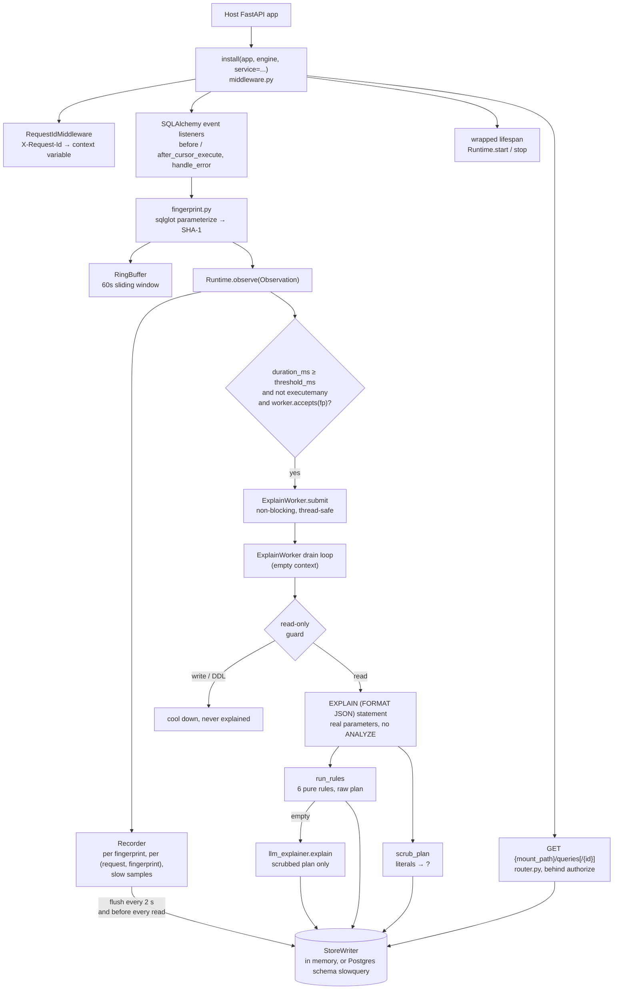
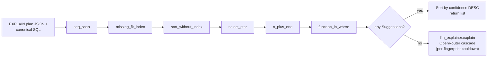
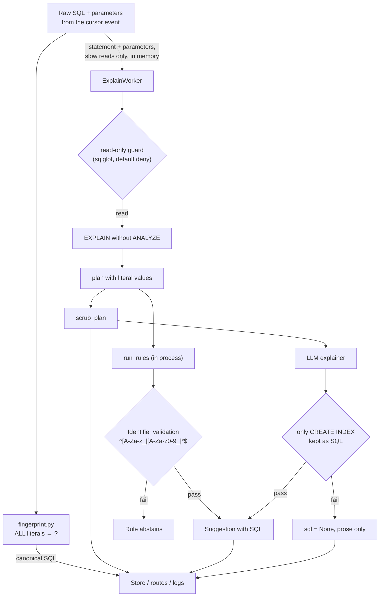

# Architecture

## Overview



## Rules dispatch

`run_rules` iterates all six rules in registration order, collects non-`None` results, sorts by confidence descending, and returns. The worker calls it with the fingerprint id and the fingerprint's recent call count from the ring buffer (what the N+1 rule needs). On empty, the worker falls back to the LLM explainer.



## Ring buffer and recorder

Each fingerprint gets a sliding-window buffer that retains samples from the last 60 seconds. Memory is capped by a fixed-size `deque(maxlen=max_samples_per_key)` that drops the **oldest** sample on overflow — the correct eviction order for a sliding window. `percentiles()` filters expired samples in place, preserving each survivor's real arrival time; `count()` reports how many samples are in the window.

The recorder is the bridge from the sync hook to the async store (upstreamed from slowquery-demo-backend's shim 4). It keeps, under one lock and within fixed bounds (10,000 fingerprints, 10,000 request aggregates, 1,000 slow samples per flush), what has happened since the last flush. `drain()` swaps it out as an immutable `Batch`; `merge_batches` (pure, associative, property-tested) combines a failed flush's batch with the next one, so a database outage loses nothing until the bounds are hit, and the overflow is counted and logged.

Slow-query detection is a per-observation `duration_ms >= threshold_ms` check, not a percentile check — the ring buffer supplies percentiles to the store at flush time, it does not gate EXPLAIN.

## Request tagging

`RequestIdMiddleware` is a pure ASGI middleware. For an HTTP request with one `X-Request-Id` header matching `^[A-Za-z0-9][A-Za-z0-9._:-]{0,127}$` it sets a `ContextVar` for the duration of the ASGI call and resets it after. Because Starlette runs `BackgroundTasks` inside that call, and `asyncio` copies the context into every task created during it, both are attributed to the request. SQLAlchemy's async adapter carries the context into the greenlet that runs the hooks. The library's own tasks (the flush loop, the EXPLAIN worker) are started with `spawn_untagged`, in an empty context, so they are never attributed to a request even when first started from inside one.

A tagged statement is always recorded; `sample_rate` applies only to untagged statements.

## The Postgres store

`PostgresStoreWriter` opens its own engine from `store_url` (pool 2 + 2, `pool_pre_ping`, `pool_recycle=300`, a 10 s connect timeout, asyncpg's statement cache off for `-pooler` hosts). The hooks are never attached to it, so its traffic is never observed. On `start()` it checks whether the six tables exist; if not, it runs the DDL in one transaction under `pg_advisory_xact_lock`, every statement `CREATE … IF NOT EXISTS`, so a boot that repeats it, and several processes booting at once, all succeed (tested by four concurrent first boots against an empty database).

| Table | Key | Notes |
|---|---|---|
| `query_fingerprints` | `(service, id)` | upsert adds calls and totals, `GREATEST(max_ms)`, `LEAST(first_seen)`, `GREATEST(last_seen)`, percentiles replaced when present |
| `request_stats` | `(service, request_id, fingerprint_id)` | additive upsert; swept by `last_seen` |
| `query_samples` | `id` (identity) | slow statements only; swept by `sampled_at` |
| `explain_plans` | `fingerprint_id` | scrubbed `jsonb`; an older plan never replaces a newer one |
| `suggestions` | `id`; unique `(fingerprint_id, kind, sql)` | `ON CONFLICT DO NOTHING`; `sql = ''` means "no DDL" so the unique key also holds for prose-only suggestions |
| `schema_version` | `version` | row `1` |

There are no foreign keys: the worker may store a plan before the flush that creates its fingerprint row. One flush is one transaction, rows written in key order so two processes take row locks in the same order.

## Lifecycle

`install()` validates every argument, then wires the store, ring buffer, recorder, worker and runtime, adds the middleware, includes the router at `mount_path`, wraps `app.router.lifespan_context` (Starlette 1.x has no `add_event_handler`) and attaches the hooks. Inside the wrapped lifespan, after the host's own startup: the hooks are re-attached if a previous lifespan detached them, the store starts (logged at ERROR and retried later if the database is unreachable), the retention sweep runs once, the worker and the two-second flush loop start. On shutdown, before the host's own: the loop stops, a final flush runs, the worker stops, the hooks detach, the LLM client and the store close. The host's engine is never disposed.

The sweep runs at startup and then at most hourly, and only after a flush that wrote something, so an idle service never wakes its database (Neon suspends idle compute).

## Security boundary



## Component map

| Module | Responsibility | Spec |
|---|---|---|
| [`fingerprint.py`](../src/slowquery_detective/fingerprint.py) | Parse via sqlglot, scrub literals + parameters, SHA-1 the canonical form | [`00`](specs/00-fingerprint.md) |
| [`buffer.py`](../src/slowquery_detective/buffer.py) | 60s sliding-window ring buffer; p50/p95/p99 and window count on demand | [`01`](specs/01-buffer.md) |
| [`hooks.py`](../src/slowquery_detective/hooks.py) | SQLAlchemy listeners; start time on the execution context; `Observation` to a callback | [`02`](specs/02-hooks.md), [`07`](specs/07-fleet-observability.md) |
| [`rules/*.py`](../src/slowquery_detective/rules/) | Six pure rules + `run_rules` dispatcher with confidence-desc ordering | [`03`](specs/03-rules.md) |
| [`llm_explainer.py`](../src/slowquery_detective/llm_explainer.py) | OpenRouter cascade with per-fingerprint cooldown and destructive-DDL scrub | [`04`](specs/04-explainer.md) |
| [`explain.py`](../src/slowquery_detective/explain.py) | Background EXPLAIN on real parameters, read-only guard, cooldown, submit gating | [`06`](specs/06-explain-worker.md), [`07`](specs/07-fleet-observability.md) |
| [`tagging.py`](../src/slowquery_detective/tagging.py) | `X-Request-Id` parsing, context variable, ASGI middleware, untagged task spawning | [`07`](specs/07-fleet-observability.md) |
| [`recorder.py`](../src/slowquery_detective/recorder.py) | Bounded aggregation between flushes; `Batch`, `merge_batches` | [`07`](specs/07-fleet-observability.md) |
| [`plan_scrub.py`](../src/slowquery_detective/plan_scrub.py) | Pure literal removal from a plan | [`07`](specs/07-fleet-observability.md) |
| [`store.py`](../src/slowquery_detective/store.py) | `StoreWriter` interface + `InMemoryStoreWriter` | [`07`](specs/07-fleet-observability.md) |
| [`pg_store.py`](../src/slowquery_detective/pg_store.py) | `PostgresStoreWriter`: DDL, batched upserts, reads, sweep | [`07`](specs/07-fleet-observability.md) |
| [`store_url.py`](../src/slowquery_detective/store_url.py) | Pure URL validation / asyncpg normalisation | [`07`](specs/07-fleet-observability.md) |
| [`schemas.py`](../src/slowquery_detective/schemas.py) | `QueryRow`, `QueryDetail` and their parts | [`07`](specs/07-fleet-observability.md) |
| [`runtime.py`](../src/slowquery_detective/runtime.py) | Hook callback, flush loop, readiness, sweep, start/stop | [`07`](specs/07-fleet-observability.md) |
| [`router.py`](../src/slowquery_detective/router.py) | The two read routes behind `authorize` | [`07`](specs/07-fleet-observability.md) |
| [`middleware.py`](../src/slowquery_detective/middleware.py) | `install()`: validation and wiring | [`05`](specs/05-middleware.md), [`07`](specs/07-fleet-observability.md) |

## Layering discipline

```
middleware ─┬─ tagging          router ── runtime ─┬─ recorder
            ├─ hooks ── fingerprint, buffer        ├─ explain ── plan_scrub, rules → llm_explainer
            ├─ router                              └─ store (StoreWriter) ← pg_store ← store_url
            └─ runtime                                       └─ schemas
```

- **Pure core:** `fingerprint`, `rules`, `plan_scrub`, `store_url`, `merge_batches` have no I/O. The runtime, the worker and the stores are the imperative shell.
- **`hooks.py` never touches a database or the network.** It times, fingerprints, records into the buffer and hands an `Observation` to the runtime.
- **`router.py` never touches SQL.** It authorizes, validates, asks the runtime to flush and reads through the `StoreWriter` interface.
- **The store never imports FastAPI.** It returns the response models defined in `schemas.py`.
- **`submit()` is sync and non-blocking.** One `put_nowait` (or `call_soon_threadsafe` from another thread) behind a set lookup; budgeted at ≤ 10 µs per call.

## Data flow for one tagged, slow query

1. A request arrives with `X-Request-Id: R`; the middleware sets the context variable.
2. The handler runs `await session.execute(stmt)`. `before_cursor_execute` stamps `time.perf_counter()` on the execution context.
3. `after_cursor_execute` computes the duration, fingerprints the statement (LRU hit), records it into the ring buffer and calls `Runtime.observe`.
4. The recorder adds the statement to the fingerprint aggregate, to `(R, fingerprint)` and, because it crossed `threshold_ms`, to the slow samples. The runtime submits an `ExplainJob` carrying the driver-level statement and parameters, unless the fingerprint is queued or cooling down.
5. Within two seconds the flush loop writes the batch to the store in one transaction (or a read route flushes first).
6. The worker dequeues the job, applies the read-only guard, runs `EXPLAIN (FORMAT JSON)` with the real parameters (no `ANALYZE`), feeds the raw plan to the rules, scrubs the plan, asks the LLM on a rules miss, sets the cooldown, and stores the scrubbed plan and the suggestions.
7. `GET /_slowquery/queries?request_id=R` (authorized by the host's hook) returns R's fingerprints with R's call counts and times; `GET /_slowquery/queries/{id}` returns the plan, suggestions and recent samples.

## Security invariants

1. **No literal value is stored, logged, served or sent to the LLM.** Fingerprinting replaces every literal before anything is recorded; a plan made with real parameters is scrubbed before it leaves the worker; driver errors are logged by class only. Real parameter values exist only in memory, between the hook and the `EXPLAIN` that plans them. Property tests cover both the fingerprinter and the scrubber, and an integration test plans a query on a secret value and checks the store, the routes and the logs.
2. **`EXPLAIN` never executes its target.** No `ANALYZE`; the read-only guard additionally refuses INSERT/UPDATE/DELETE/MERGE, data-modifying CTEs, `DO`/`CALL` and DDL. An integration test explains a statement that calls a sequence-advancing function and checks the sequence did not move.
3. **No route without authorization.** Every route depends on the host's `authorize` hook; no hook means 403, a verdict other than `True` means 403, and the check runs before parameter validation.
4. **Rule-generated identifiers are whitelist-checked.** Every table/column name a rule formats into SQL must match `^[A-Za-z_][A-Za-z0-9_]*$` or the rule abstains. Reserved-word collisions are double-quoted.
5. **No rule source contains `DROP`, `ALTER`, `TRUNCATE`, `GRANT`, `REVOKE`, `UPDATE`, or `DELETE`.** A grep-based regression guard runs on every CI build.
6. **LLM responses are filtered.** If the model proposes anything other than `CREATE INDEX ...`, the suggestion is kept as prose with `sql = None`. API keys are held in `SecretStr` and never logged.
7. **The library never applies DDL.** 0.2.0 removed the 0.1 `apply` route; suggestions are data.

## Test layout

| Layer | Count | Runs in CI? |
|---|---|---|
| Unit (`tests/unit/`) | 449 | Yes — `test` job, branch coverage ≥ 90 % |
| Integration (`tests/integration/`, Testcontainers Postgres 16) | 56 (3 of them `@slow`) | Yes — `integration` job runs the 53 non-slow ones with the unit tier, branch coverage ≥ 95 % overall and ≥ 85 % per module |
| Slow (`@pytest.mark.slow`) | 6 | No — benchmark-style, `uv run pytest -m slow` |
| **Total** | **508** | |

`tests/store_contract.py` is one behavioural contract run against both stores (in memory in the unit tier, Postgres in the integration tier). `tests/integration/test_fleet_flow.py` is the composed flow: a FastAPI app on a real asyncpg engine, tagged requests, background tasks, slow statements, restarts and shutdown.
